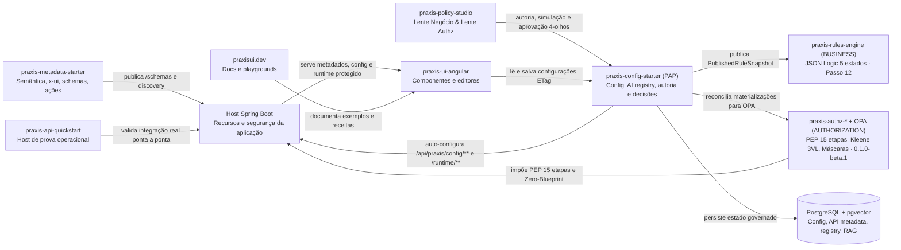
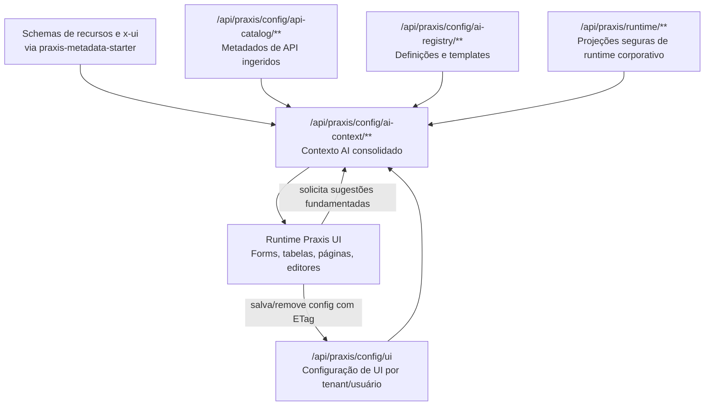
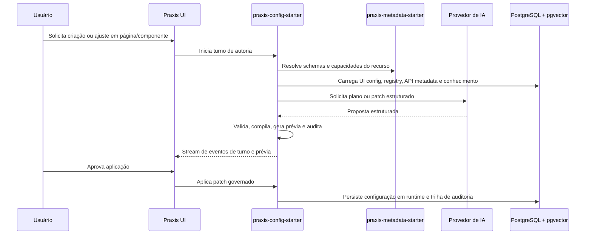

# Praxis Config Starter

[](https://central.sonatype.com/artifact/io.github.codexrodrigues/praxis-config-starter)


[](LICENSE)

`praxis-config-starter` é o plano de controle (**PAP — Policy Administration Point**) canônico de configuração, decisões semânticas e governança de IA para hosts Spring Boot da [**Praxis Platform**](https://praxisui.dev/).

A **Praxis** é uma **plataforma semanticamente orientada para aplicações corporativas AI-native**, em que **recursos, regras, ações, dados e políticas são descritos uma vez** e operados uniformemente por **interfaces tradicionais, interfaces generativas, agentes de IA e integrações** — construindo aplicações legíveis e operáveis por IA por design, em vez de colar IA lateralmente ao sistema.

Dentro dessa arquitetura, `praxis-config-starter` é dono da persistência e da semântica de runtime para:

- **`ui_user_config`:** estado JSON executável por tenant, usuário, ambiente, versão e `ETag`, além de fonte semântica de autoria atestada pelo servidor na mesma revisão.
- **`ai_registry`:** definições governadas de componentes, templates e manifestos executáveis de autoria.
- **`api_metadata`:** metadados ingeridos do catálogo de APIs para busca estruturada e *grounding* de IA.
- **`/api/praxis/config/**`:** APIs de configuração, registry, contexto de IA, autoria agêntica, streaming e decisões governadas de domínio.
- **`/api/praxis/runtime/context`, `/api/praxis/runtime/tenants`, `/api/praxis/runtime/navigation`**, trocas de contexto e eventos de segurança/runtime: projeções corporativas seguras para shells de UI e grounding de IA.
- **Orquestração de provedores de IA**, recuperação RAG/*Project Knowledge*, acesso assinado a streams SSE e diagnósticos de autoria governada.

`praxis-config-starter` não define semântica de recursos de domínio (papel de [`praxis-metadata-starter`](https://github.com/codexrodrigues/praxis-metadata-starter)) nem renderiza UI (papel de [`praxis-ui-angular`](https://github.com/codexrodrigues/praxis-ui-angular)). Documentação pública, exemplos e playgrounds ficam em [praxisui.dev](https://praxisui.dev/).

## Fronteiras no Ecossistema Praxis (Source of Truth)

| Responsabilidade / Plano | Dono Canônico |
| --- | --- |
| Semântica de recursos backend, `x-ui`, `/schemas/filtered`, discovery e capabilities | [`praxis-metadata-starter`](https://github.com/codexrodrigues/praxis-metadata-starter) |
| Configuração em runtime, projeção de contexto corporativo, `ai_registry`, `api_metadata`, templates, autenticação de stream e plano de controle (PAP) de decisões governadas (`decisionKind = BUSINESS` e `decisionKind = AUTHORIZATION`) | **`praxis-config-starter`** (este repositório) / [`praxis-config-contracts`](https://github.com/codexrodrigues/praxis-config-contracts) |
| Avaliação determinística de regras de negócio em 5 estados (`decisionKind = BUSINESS`, `RuleSet`, JSON Logic, `RuleParameterTemplate`, executada no Passo 12 sobre estado real não mascarado) | [`praxis-rules-engine`](https://github.com/codexrodrigues/praxis-rules-engine) |
| Contratos neutros, pipeline PEP de 15 etapas, compilador/adaptador OPA Rego v1 e auto-configuração Spring Boot de autorização e proteção de dados (`decisionKind = AUTHORIZATION`, `0.1.0-beta.1` no Maven Central) | [`praxis-authz-contracts`](https://github.com/codexrodrigues/praxis-authz-contracts) · [`praxis-authz-enforcement-core`](https://github.com/codexrodrigues/praxis-authz-enforcement-core) · [`praxis-authz-opa`](https://github.com/codexrodrigues/praxis-authz-opa) · [`praxis-authz-starter`](https://github.com/codexrodrigues/praxis-authz-starter) |
| Estação de autoria e simulação com aprovação 4-olhos (**Lente de Regras de Negócio** e **Lente de Acesso e Proteção de Dados**) | [`praxis-policy-studio`](https://github.com/codexrodrigues/praxis-policy-studio) |
| Renderização Angular metadata-driven, materializadores, editores e APIs de integração de host | [`praxis-ui-angular`](https://github.com/codexrodrigues/praxis-ui-angular) |
| Site oficial público, exemplos, playgrounds e documentação da plataforma | [praxisui.dev](https://praxisui.dev/) |
| Host operacional completo e provas HTTP ponta a ponta | [`praxis-api-quickstart`](https://github.com/codexrodrigues/praxis-api-quickstart) |

### Do Plano de Controle até o OPA e o Código de Negócio (Ganhos de Mercado, Tokens e Velocidade)

Enquanto soluções de mercado fragmentam configuração de UI, catálogo de APIs para IA, fluxos de aprovação *maker-checker* de regras funcionais e bundles de segurança OPA em ferramentas desconexas (e sem rastreabilidade criptográfica), o `praxis-config-starter` unifica o **PAP (Policy Administration Point)** em cima de snapshots imutáveis:

- **Reconciliação Governada para OPA (`ConfigMaterializationToOpaReconciler`):** No plano `decisionKind = AUTHORIZATION`, cabeças aprovadas de `DomainRuleMaterialization` são compiladas deterministicamente por [`praxis-authz-opa`](https://github.com/codexrodrigues/praxis-authz-opa) em `OpaBundleArtifact`, verificadas por corpus positivo/negativo anti-`denyAll` e sincronizadas com o [`praxis-authz-starter`](https://github.com/codexrodrigues/praxis-authz-starter) no startup e em rotações seguras;
- **Economia de Tokens de IA e Velocidade Corporativa:** Ao concentrar grounding de APIs (`/api/praxis/config/ai-context/**`), catálogo semântico e decisões publicadas em um único control plane versionado, agentes de IA consultam apenas o recorte exato do recurso — evitando ler repositórios inteiros de regras ou reescrever código Java/Rego a cada alteração funcional ou normativa.

## Relacionamento com o `praxis-metadata-starter`

`praxis-metadata-starter` e `praxis-config-starter` são starters backend complementares, nunca substitutos:

`praxis-metadata-starter` é a fonte canônica para metadados orientados a recursos:
- chaves de recurso e controllers semânticos;
- vocabulário `x-ui` e anotações de schema;
- saída estrutural em `/schemas/filtered`;
- descoberta de superfícies, ações e capacidades;
- modelo de resolução de operações e schemas consumido por runtimes UI e hosts.

`praxis-config-starter` consome e enriquece essa fronteira de metadados com estado governado em runtime:
- configuração persistida de UI por tenant, ambiente, usuário, recurso e componente;
- projeção segura de contexto corporativo para shells e grounding de IA;
- ingestão de metadados de API usada por busca, RAG e contexto de autoria;
- definições de `ai_registry`, manifestos de autoria, templates e diagnósticos;
- acesso a streaming via cookie ou URL assinada para fluxos de autoria compatíveis com browser;
- decisões governadas de domínio e workflows de materialização sob `/api/praxis/config/**`;
- workspaces de mudança do Rules Studio com concorrência por `ETag` forte e cenários reutilizáveis de 5 estados documentados em [`docs/domain-rules/change-workspaces-v1.md`](docs/domain-rules/change-workspaces-v1.md) (mantendo `RESOURCE_KEY` semântico distinto de `RESOURCE_PATH` HTTP para evitar inferência de URL).

Quando os dois starters divergirem, trate `praxis-metadata-starter` como autoritativo para semântica de recursos/schemas e `praxis-config-starter` como autoritativo para configuração, IA, autoria e persistência.

## Como se Encaixa no Ecossistema

`praxis-config-starter` conecta metadados de recursos, motores de decisão (`BUSINESS` e `AUTHORIZATION`), UI Angular e persistência governada:







## Quando Usar

Adote este starter quando um host Spring Boot precisar de:
- configuração remota para componentes `@praxisui/*` com leitura/escrita por tenant e usuário controlada por `ETag`;
- registro de IA governado para templates de componentes e manifestos de autoria;
- ingestão de catálogo de APIs para *grounding* e recuperação vetorial (RAG);
- roteamento para provedores OpenAI, Gemini, APIs compatíveis xAI/OpenAI e modo `mock`, com *Server-Sent Events* (SSE);
- workflows governados de regras de negócio (`decisionKind = BUSINESS`), políticas de autorização (`decisionKind = AUTHORIZATION`) e conhecimento de domínio (*Domain Knowledge*).

Planos de edição de componentes distinguem tipos de operação da cardinalidade de alvos afetados: a seleção semântica lista cada `operationId` do manifesto uma vez, enquanto o plano de materialização pode repeti-lo por alvo fundamentado até o orçamento do turno.

## Instalação

Adicione a dependência ao host Spring Boot consumindo a versão publicada no Maven Central:

```xml
<dependency>
    <groupId>io.github.codexrodrigues</groupId>
    <artifactId>praxis-config-starter</artifactId>
    <version>${praxis.config.version}</version>
</dependency>
```

Requisitos mínimos de runtime:
- **Java 21+** (exigido pelo contrato canônico de snapshot do `praxis-rules-engine`)
- **Spring Boot 3.5+**
- **Swagger Jakarta 2.2.47** (preparo `rc.158`, sem annotations não Jakarta trazidas pelo SDK OpenAI; confira a árvore efetiva do host)
- **PostgreSQL 14+** e extensão **`pgvector`** quando busca vetorial/RAG estiver habilitada

Hosts que publicam snapshots `RuleSet` apoiados em Java devem fornecer um `DomainRuleImplementationCatalog` (padrão *deny-all*, escopado por tenant/ambiente/host, jamais derivado do próprio snapshot publicado); extensões Java de cliente exigem o contrato assinado/allowlisted `RuleExtensionTrust` (`praxis-rules-engine` contrato `1.2`).

Hosts que carregam o snapshot ativo em processo consomem o contrato neutro `PublishedRuleSnapshotHeadReader` de [`praxis-config-contracts`](https://github.com/codexrodrigues/praxis-config-contracts). Ausência de cabeça retorna vazio, enquanto falhas de integridade, escopo ou acesso falham explicitamente sem fallback inferido. Veja [Plano de controle de snapshots v1](docs/domain-rules/snapshot-control-plane-v1.md), [Histórico de aplicação de materializações](docs/domain-rules/materialization-application-history.md) e [Resolução operacional de políticas](docs/domain-rules/operational-policy-resolution.md).

## Configuração Mínima

```yaml
spring:
  datasource:
    url: ${PRAXIS_DB_URL}
    username: ${PRAXIS_DB_USERNAME}
    password: ${PRAXIS_DB_PASSWORD}
  jpa:
    hibernate:
      ddl-auto: none
  flyway:
    locations: classpath:db/migration
    baseline-on-migrate: true

praxis:
  ai:
    api-key:
      encryption-key: ${PRAXIS_AI_API_KEY_ENCRYPTION_KEY}
    keys:
      admin-token: ${PRAXIS_AI_KEYS_ADMIN_TOKEN}
      require-admin-token: true
    stream:
      auth:
        mode: cookie
```

O baseline compacto (`classpath:db/baseline`) é uma conveniência limitada às superfícies básicas de configuração, metadados de API, registry de UI e snapshot-store declaradas nele — não substitui `classpath:db/migration` quando o host utilizar definições governadas de regras, aprovações IAM (`V36`), materializações, *Domain Knowledge*, federação e stores avançados de autoria IA:

```properties
spring.flyway.locations=classpath:db/baseline
```

## Configuração de Provedores de IA

Credenciais de provedores devem vir exclusivamente de variáveis de ambiente ou gerenciador de segredos do host — nunca versione chaves reais.

Áudio no compositor governado utiliza `POST /api/praxis/config/ai/transcriptions` e a seleção dedicada `praxis.ai.transcription.provider` / `praxis.ai.transcription.model`. Hosts podem consultar `GET /api/praxis/config/ai/transcriptions/capabilities` com o mesmo escopo de principal antes de oferecer captura; sua resposta `{ "available": boolean }` reporta suporte local e credencial configurada (sem chamar o provedor externo nem certificar cota), falhando fechado (`false`) em erro de lookup. A admissão de identidade corporativa do host roda antes (retornando `401/403/409/503` em rejeição de sessão/escopo/versão/fonte). Não infira disponibilidade de áudio a partir do status do chat nem exponha credenciais ao navegador.

```yaml
spring:
  ai:
    openai:
      api-key: ${PRAXIS_AI_OPENAI_API_KEY:${OPENAI_API_KEY:}}
      base-url: ${PRAXIS_AI_OPENAI_BASE_URL:https://api.openai.com}
      chat:
        options:
          model: ${PRAXIS_AI_OPENAI_MODEL:gpt-4o-mini}
    google:
      genai:
        api-key: ${PRAXIS_AI_GEMINI_API_KEY:${GEMINI_API_KEY:}}
        chat:
          options:
            model: ${PRAXIS_AI_GEMINI_MODEL:gemini-2.5-flash}

praxis:
  ai:
    provider: ${PRAXIS_AI_PROVIDER:mock}
    openai:
      light-reasoning-models: ${PRAXIS_AI_OPENAI_LIGHT_REASONING_MODELS:gpt-5.6-luna,gpt-5.6-terra}
    embedding:
      provider: ${PRAXIS_AI_EMBEDDING_PROVIDER:mock}
```

Para fluxos locais de navegador via `EventSource` que não permitem headers customizados, habilite URLs assinadas de stream com segredo estável (substitua por segredo de produção gerenciado fora do repositório):

```properties
praxis.ai.stream.auth.mode=signed-url-token
praxis.ai.stream.auth.token-secret=${PRAXIS_AI_STREAM_AUTH_TOKEN_SECRET}
```

## Configuração de Runtime de Autoria e Indexação

Caches locais de autoria agêntica têm escopo estritamente limitado para performance e não são fonte da verdade (`ai_registry`, `api_metadata`, metadados de runtime e eventos persistidos continuam canônicos).

A resolução de intenção é estritamente **semântica primeiro e *fail-closed***:
- A intenção do usuário é classificada pelo contrato estruturado da LLM (`AgenticAuthoringLlmIntentResolution`: `semanticIntentClass`, `operationKind`, `artifactKind`, `changeKind`, `requiresGovernedAuthoring`, `localEditorialComposition`, `semanticRefinement`, `queryConstraints`, `visualizationDecision`, `consultativeRetrievalPlan`) ou por tokens assinados pelo servidor (`semanticDecision`, `governedResourceConfirmation`, `contextualPreviewAction`).
- Fallbacks lexicais por palavras-chave sobre prompts crus são proibidos; falhas no provedor (`provider_error`) ou intenções não resolvidas (`resolved=false`) falham fechado sem mutar configuração nem memória de decisão da sessão (`activeSemanticDecision`).
- Autoria governada de recursos (`requiresGovernedAuthoring=true` ou `selectedResourcePath` não vazio) sempre prevalece sobre `localEditorialComposition`.

| Propriedade | Padrão | Observações |
| --- | --- | --- |
| `praxis.ai.authoring.component-capabilities.cache-ttl-ms` | `600000` | TTL de descoberta de capacidades de componentes (atualizado/invalidado no bootstrap e alterações do registry; use `0` para desabilitar cache local em testes interativos). |
| `praxis.ai.authoring.component-capabilities.registry-load-timeout-ms` | `30000` | Timeout máximo da projeção focal do AI Registry (reporta proveniência degradada sem gravar pelo TTL normal). |
| `praxis.ai.authoring.component-capabilities.degraded-retry-ms` | `5000` | Janela curta de retentativa após timeout ou falha de carga do registry. |
| `praxis.ai.authoring.component-capabilities.preload-timeout-ms` | `35000` | Orçamento de pré-carga do turno (alinhado a pelo menos `registry-load-timeout-ms + 1s`). |
| `praxis.ai.authoring.consultative.api-catalog.compact-cache-ttl-ms` | `60000` | TTL de projeções compactas do catálogo de APIs para respostas consultivas (`0` força projeção nova). |
| `praxis.ai.authoring.consultative.api-catalog.compact-cache-max-entries` | `256` | Máximo de entradas compactas retidas em cache por instância. |
| `praxis.ai.authoring.consultative.api-catalog.api-metadata-cache-ttl-ms` | `60000` | TTL para consultas a `api_metadata` na projeção consultiva. |
| `praxis.ai.retry.max-attempts` | `2` | Máximo de tentativas por chamada canônica de *embedding* (apenas falhas transitórias de transporte/timeout/rate-limit/capacidade sofrem retry; cota, autenticação e erros de cliente falham fechado). |
| `praxis.ai.retry.initial-delay-ms` | `500` | Atraso inicial limitado antes da retentativa de embedding. |
| `praxis.ai.retry.max-delay-ms` | `2000` | Teto de atraso para retentativa (um `Retry-After` superior falha imediatamente permitindo recuperação via `reconcile`). |
| `praxis.api-metadata.rag-publication.enabled` | `true` | Habilita publicação de documentos RAG derivados de `api_metadata` pelo worker gerenciado. |
| `praxis.api-metadata.indexing.worker-count` | `1` | Número de workers de indexação do API Catalog (isolados por tenant, ambiente, serviço e release). |
| `praxis.api-metadata.indexing.queue-capacity` | `32` | Limite de escopos distintos aguardando indexação (saturação persiste `FAILED` com `INDEXING_QUEUE_SATURATED`). |
| `praxis.api-metadata.indexing.coalesce-delay-ms` | `750` | Janela de coalescência para combinar uploads rápidos de chunks da mesma release. |
| `praxis.api-metadata.indexing.shutdown-timeout-seconds` | `10` | Orçamento de encerramento gracioso dos workers; trabalho `PENDING`/`PROCESSING` interrompido é retomado no próximo boot. |

## Semântica de Identidade em UI Config (`/api/praxis/config/ui`)

`/api/praxis/config/ui` normaliza a identidade lógica na fronteira do serviço antes de buscar, atualizar ou remover: `tenantId`, `componentType` e `componentId` são obrigatórios e passam por `trim()`; `X-User-ID`, `X-Env` e `X-Updated-By` em branco são tratados como ausentes (portanto ambiente em branco aponta para o escopo global `environment IS NULL`).

Os limites de coluna em `ui_user_config` são validados antes do repositório ou *upsert* atômico PostgreSQL: tenant, usuário, updater e componentId até `255` caracteres; tipo de componente e ambiente até `64` caracteres (`400 Bad Request` para entradas inválidas). `scope=user` exige `X-User-ID` não vazio; escopo `tenant` ignora identidade de usuário na persistência.

Na autoria governada de páginas, `page-apply` persiste a página executável em `payload` e o `UiCompositionPlan` terminal no campo irmão `authoringSource` com hashes canônicos e linhagem do servidor. Escritas genéricas via `PUT` não podem enviar `authoringSource` substituto e limpam a origem anterior na mesma revisão sempre que o payload executável mudar (evitando que editores reabram semântica obsoleta).

## Requisições Condicionais em UI Config

`/api/praxis/config/ui` publica semântica HTTP `ETag` para leituras em cache e escritas protegidas:
- `GET` expõe o validador no header `ETag` e no corpo; clientes podem enviar `If-None-Match` (`*`, ETag forte/fraca entre aspas ou lista separada por vírgula) recebendo `304 Not Modified` quando compatível.
- `PUT` e `DELETE` aceitam `If-Match` com `*` (exige registro existente; ausência retorna `412 Precondition Failed`) ou lista de ETags fortes entre aspas; validadores fracos não satisfazem `If-Match` e tokens malformados retornam `400 Bad Request`.

## Semântica de Revisão do AI Registry

`ai_registry.version` e `ai_registry.etag` atuam como tokens de atualização: inserções iniciam em `version=1`, avançando apenas quando muda o estado material persistido (payload, embedding, tags, origem, referência ou status). Reingestões idênticas preservam ambos os tokens.

Upserts de templates persistem o documento canônico mesmo se a geração de embedding falhar de forma normalizada (mantendo busca por chave exata, porém excluindo das buscas vetoriais até um próximo upsert bem-sucedido). Leituras e upserts de templates expõem `revision.version`, `revision.etag` e `revision.configSha256` (calculado apenas do `configJson` canônico; `GET` de template publica também o header HTTP `ETag`).

Um documento intermediário `praxis.ui-composition-plan` pode carregar `templateRef` exato (`registryKey + configSha256`): a prévia resolve estritamente o template ativo exato, valida `configJson.authoringPlan`, registra evidência de revisão e expande antes do compilador puro, falhando fechado para referências inativas ou divergentes (renderização da página compilada não requer acesso posterior ao registry). Consulte o desenho de referência em [`docs/ai/agentic-authoring/implementation/43-governed-page-template-reference.md`](docs/ai/agentic-authoring/implementation/43-governed-page-template-reference.md).

## Semântica de Escopo e Indexação em API Metadata

`api_metadata` é o corpus estruturado canônico de grounding de APIs com identidade isolada por `(tenant, environment, serviceKey, releaseId, path, method)`. A ingestão reconcilia endpoints movidos por `operationId` somente dentro do mesmo escopo, e a recuperação RAG/vetorial nunca faz fallback entre tenants.

Nos fluxos de criação governada de formulários/páginas (`/minimal-form-plan` e `/page-preview`), a ausência do schema `/schemas/filtered` selecionado falha fechado sem permitir que a LLM invente campos. Para saídas estruturadas do provedor LLM (`MinimalFormPlan`), o JSON Schema empacotado permanece como contrato canônico validado após decodificação.

A ingestão (`POST /api/praxis/config/api-catalog/ingest`) persiste as linhas canônicas em transação curta e retorna `202 Accepted`; o worker gerenciado materializa os índices em segundo plano e o cliente acompanha via `GET /api/praxis/config/api-catalog/rag/status?serviceKey=...&releaseId=...` (`PENDING`/`PROCESSING` → `READY` ou `FAILED` com código/mensagem sanitizada) ou dispara reconstrução idempotente com `POST /api/praxis/config/api-catalog/rag/reconcile`. Mudanças no perfil efetivo de embeddings invalidam vetores de perfis anteriores; publicações do AI Registry e Domain Catalog expurgam documentos vetoriais de releases superadas (inspecionável sem deleção em `GET /api/praxis/config/ai-registry/releases/{releaseId}/cleanup-plan`). Os metadados vetoriais excluem propositalmente o `jsonSchema` completo, hidratando-o do registro ativo após ranquear os chunks, e a reordenação híbrida (BM25 + RRF) atua apenas sobre o pool retornado pela busca vetorial escopada. Filtros `tags` aceitam separadores `,`, `;` ou `|` com correspondência case-insensitive `AND`.

## Principais Superfícies HTTP

| Superfície | Finalidade |
| --- | --- |
| `/api/praxis/config/ui` | Leitura, gravação e remoção de UI config por tenant/usuário; hosts podem registrar `UiConfigWriteAuthorizer` para autorizar escritas por identidade e capacidade do servidor. |
| `/api/praxis/config/api-catalog/**` | Ingestão e busca de `api_metadata` para grounding e RAG. |
| `/api/praxis/config/ai-registry/**` | Gestão de definições de componentes, templates (`ETag` + `revision`) e projeções de manifestos. |
| `/api/praxis/config/ai-context/**` | Montagem de contexto de IA combinando catálogo de componentes, runtime, templates e dicas de schema. |
| `/api/praxis/config/ai/patch` | Geração de patches estruturados a partir do contexto governado de IA. |
| `/api/praxis/config/ai/authoring/**` | Validação, compilação, prévia, aplicação, stream SSE, replay e cancelamento de turnos de autoria agêntica. |
| `/api/praxis/config/domain-rules/**` | Governança compartilhada de regras de negócio e decisões semânticas (publicação imutável sem seleção de cabeça, ativação explícita e rollback). |
| `GET /api/praxis/config/domain-rules/snapshots` | Lista versões escopadas e estado atual de admissão (incluindo `RUNTIME_INCOMPATIBLE`; versões diferentes de `READY` ficam `UNAVAILABLE`). |
| `POST /api/praxis/config/domain-rules/snapshots` | Publica apenas conteúdo aprovado imutável (ETag = hash do conteúdo; nenhuma cabeça é criada ou alterada). |
| `POST /api/praxis/config/domain-rules/snapshots/{snapshotKey}/activate` | Seleciona conteúdo mais novo com `If-Match` forte (ou bootstrap `If-None-Match: *` com rollout pronto sob política `REQUIRED`). |
| `POST /api/praxis/config/domain-rules/snapshots/{snapshotKey}/rollback` | Move a cabeça escopada para uma publicação anterior verificada usando `If-Match` forte. |
| `GET /api/praxis/config/domain-rules/snapshots/head/status` | Reavalia prontidão com `200`/`no-store` preservando ETag da cabeça para CAS sem expor conteúdo do snapshot. |
| `POST /api/praxis/config/domain-rules/snapshots/execution-observations` | Ingere lote limitado e idempotente de evidências redigidas de um host autenticado. |
| `GET /api/praxis/config/domain-rules/snapshots/{snapshotKey}/execution-summary` | Lê agregados seguros de desfecho/contagem/tempo sem fatos, payloads ou identidades individuais de host. |
| `POST /api/praxis/config/domain-rules/snapshots/host-status` | Substitui o heartbeat redigido mais recente do host autenticado sem aceitar escopo ou identidade no corpo. |
| `GET /api/praxis/config/domain-rules/snapshots/head/host-status-summary` | Compara relatos frescos de hosts com a cabeça ativa e coordenadas de runtime (`aligned`, `snapshot-drifted`, `incompatible`, `unavailable`, `stale`). |
| `POST /api/praxis/config/domain-rules/snapshots/rollouts` | Cria rollout observacional de pré-carga vinculado à ETag forte atual da cabeça. |
| `POST /api/praxis/config/domain-rules/snapshots/rollouts/{rolloutId}/probes` | Atualiza a sonda monotônica redigida de candidato do host sem alterar o heartbeat ativo. |
| `GET /api/praxis/config/domain-rules/snapshots/rollouts/pending?ruleSetKey=...` | Permite ao observador autenticado descobrir o candidato não expirado mais recente vinculado à cabeça inalterada. |
| `GET /api/praxis/config/domain-rules/snapshots/rollouts/{rolloutId}/readiness` | Retorna contagens de quórum de candidato derivadas no servidor sem identidades de host. |
| `POST /api/praxis/config/domain-rules/snapshots/rollouts/{rolloutId}/cancel` | Encerra um rollout observacional sem alterar a cabeça ativa do `RuleSet`. |
| `POST /api/praxis/config/domain-rules/snapshots/rollout-policies` | Cria nova versão imutável `DRAFT` de política de rollout como `RULE_DEFINITION_AUTHOR`. |
| `GET /api/praxis/config/domain-rules/snapshots/rollout-policies?ruleSetKey=...` | Lê a política ativa, catálogo de versões e ETag independente como `RULE_SNAPSHOT_READER`. |
| `POST /api/praxis/config/domain-rules/snapshots/rollout-policies/{policyId}/approve` | Aprova rascunho exato por meio de `RULE_DEFINITION_APPROVER` distinto. |
| `POST /api/praxis/config/domain-rules/snapshots/rollout-policies/{policyId}/activate` | Seleciona política aprovada como `RULE_SNAPSHOT_OPERATOR` e `If-Match` forte (rollouts abertos bloqueiam a transição). |
| `GET /api/praxis/config/domain-rules/snapshots/rollout-policies/timeline?ruleSetKey=...` | Lê a timeline *append-only* segura da política sem duplicação de payload. |
| `/api/praxis/config/domain-knowledge/**` | Governa *change sets* de Conhecimento de Domínio e ciclo de evidências. |
| `GET /api/praxis/runtime/context` | Retorna estado de seleção e versão opaca; somente `ready` traz o contexto efetivo confirmado pelo host. |
| `GET /api/praxis/runtime/context/choices` | Descobre escolhas autorizadas limitadas via referências opacas e cursor vinculado a sessão/consulta. |
| `PUT /api/praxis/runtime/context` | Submete `choiceRef` e `expectedSelectionVersion`, retornando a mesma projeção canônica após seleção autorizada. |
| `GET /api/praxis/runtime/tenants` | Retorna tenants/empresas acessíveis providos pelo host (`503 RUNTIME_PROVIDER_UNAVAILABLE` sem provider). |
| `GET /api/praxis/runtime/navigation` | Retorna nós de navegação do shell corporativo com referências opcionais (`resourceKey`, `surfaceRef`, `actionRef`, `moduleKey`, `capabilityRef`). |
| `GET /api/praxis/runtime/security-events` | Retorna sinais seguros de runtime/segurança sem nunca expor roles crus, políticas, tokens, prompts, SQL ou auditoria interna. |

## Documentação e Fluxo de Aprovação 4-Olhos

Documentos essenciais neste repositório:
- [Contratos de IA](docs/ai/contracts/README.md)
- [Streaming de autoria agêntica](docs/ai/agentic-authoring-streaming.md)
- [Guia de memória e PII](docs/ai/memory-and-pii.md)
- [Plano de controle de snapshots de regras v1](docs/domain-rules/snapshot-control-plane-v1.md)
- [Observações de execução de regras v1](docs/domain-rules/execution-observations-v1.md)
- [Status de host em domain-rules v1](docs/domain-rules/host-status-v1.md)
- [Prontidão de ativação escalonada v1](docs/domain-rules/staged-activation-readiness-v1.md)
- [Workspaces de mudança do Rules Studio v1](docs/domain-rules/change-workspaces-v1.md)
- [Checklist de release para enforcement em runtime](docs/ai/runtime-enforcement-consumer-release-checklist-2026-05-02.md)
- [Contrato do Catálogo de Domínio](docs/domain-catalog/domain-catalog-contract-v0.2.md)
- [Processo de Release](RELEASING.md)

A publicação de `RuleSet` segue fluxo *maker-checker* estrito: solicite `POST /api/praxis/config/domain-rules/snapshots/composition-manifest`, obtenha duas aprovações segregadas via `POST /api/praxis/config/domain-rules/snapshots/composition-approvals` por aprovadores autenticados distintos e submeta o candidato inalterado com esse digest por outro publicador autenticado. Em modo corporativo o host deve mapear os papéis IAM `RULE_DEFINITION_READER`, `RULE_DEFINITION_AUTHOR`, `RULE_DEFINITION_APPROVER`, `RULE_COMPOSITION_APPROVER`, `RULE_SNAPSHOT_PUBLISHER`, `RULE_SNAPSHOT_OPERATOR` e `RULE_SNAPSHOT_READER` (além de `RULE_EXECUTION_OBSERVER` para hosts que publicam observações/sondas) — atores enviados no corpo da requisição jamais substituem o principal e o escopo resolvidos no servidor.

Workspaces do [`praxis-policy-studio`](https://github.com/codexrodrigues/praxis-policy-studio) exigem um *Test Run* atual, aprovado e gravado com idempotência antes da submissão, vinculado à revisão exata do workspace. Determinações reativas pertencentes ao backend são materializadas explicitamente como `backend_determination/resource-reactive-determination` e consumidas apenas quando `status=applied`, mantendo unicidade por `targetLayer + targetArtifactType + targetArtifactKey`.

O host operacional público de referência para validação ponta a ponta é o [`praxis-api-quickstart`](https://github.com/codexrodrigues/praxis-api-quickstart).

## Desenvolvimento e Verificação

Execute o perfil smoke do starter:

```powershell
mvn -B -P ci-smoke-unit -T 1C clean verify
```

Para mudanças que impactam autoria de IA, streaming, gates de release ou integração com o quickstart, siga [RELEASING.md](RELEASING.md) e o workflow `.github/workflows/agentic-authoring-smoke.yml`. Arquivos locais de credenciais como `.env.openai.local.ps1` são ignorados pelo Git; nunca comite chaves reais de provedores.

`GET /api/praxis/config/domain-rules/definitions/capabilities` projeta por definição somente as ações autorizadas pelo principal e escopo resolvidos no servidor (incluindo `CREATE_NEW_VERSION`), sem inferência no cliente.

### Parâmetros governados (`Engine` contrato `1.6`)

`GET /api/praxis/config/domain-rules/definitions/{definitionId}/parameters` exige `RULE_DEFINITION_READER` no escopo resolvido no servidor com `X-Tenant-ID` e `X-Env`, projetando `praxis.domain-rule-parameter-catalog.v1` a partir de `definition.parameterTemplate` (`RuleParameterTemplate` do [`praxis-rules-engine`](https://github.com/codexrodrigues/praxis-rules-engine)) e `parameters.parameterValues`. Valores escalares são ligados a literais por JSON Pointer; executores Java puros não são parametrizáveis neste contrato, e cada binding `PARAMETERIZE` na composição exige fonte aprovada única com `bindingKey == ruleKey`, template e valores canonicamente idênticos.

Validação focal sem banco:

```bash
mvn -Dtest=DomainRuleParametersTest,DomainRuleChangeWorkspaceServiceTest,DomainRuleControllerTest,DomainRuleServiceTest,DomainRuleSnapshotServiceTest test
```

`GET /api/praxis/config/domain-rules/definitions/{definitionId}/facts` projeta o vocabulário versionado `definition.factCatalog` submetido ao mesmo papel `RULE_DEFINITION_READER` e incluído no fingerprint imutável da definição. O assistente pode descobrir decisões pela tool interna *read-only* `searchDomainRules` de forma consultiva (`canApply=false`), exigindo releitura atestada e os gates canônicos para qualquer mutação.

## Licença

Distribuído sob a licença Apache License 2.0. Consulte [LICENSE](LICENSE).

## Fundação de UI Layout Workspace e Evolução

A [fundação de workspace de layout UI](docs/ui-layout-workspace-foundation.md), o [contexto de validação de ciclo de vida](docs/ai/contracts/ui-layout-validation-attempt.md), o [serviço Java de evidência histórica](docs/ui-layout-historical-evidence.md), o [serviço Java de prontidão de evolução](docs/ui-layout-evolution-readiness.md), a [fronteira de workspace (`P3.2h.5b`)](docs/ui-layout-authoring-workspace.md), a [fronteira interna de captura de metadados](docs/ai/contracts/ui-layout-metadata-capture-internal.md), o [armazenamento append-only V66/V67/V68](docs/ai/contracts/ui-layout-metadata-capture-storage-internal.md) e o [contrato de gravador de metadados de baseline](docs/ai/contracts/ui-layout-baseline-metadata-writer.md) estabelecem a base de captura UTF-8, orçamentos cooperativos de ciclo de vida e admissão histórica de layouts Tabela B0/patch/C0 (permanecendo *rebase* automático B0/C0/B1 e provas operacionais completas como etapas específicas de evolução).

## Política de CI e publicação

Validação local durante desenvolvimento; Actions apenas no fechamento necessário de versões. Consulte [ACTIONS-RELEASE-POLICY.md](ACTIONS-RELEASE-POLICY.md) para gatilhos, gates e recuperação.

## Publicação governada de páginas

Criação/cópia de páginas e identidade estão descritas em [P2](docs/ai/contracts/page-publication-p0/P2-IMPLEMENTATION.md). A integridade transacional entre heads independentes de páginas e grupos, requisitos do host e provas Neon estão em [P3-A](docs/ai/contracts/page-publication-p0/P3A-IMPLEMENTATION.md). Adoção dos hosts e catálogo HTTP de navegação seguem etapas próprias.
