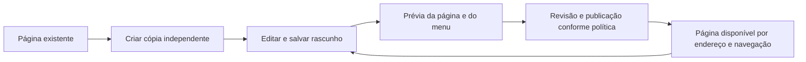

# Páginas derivadas e publicação corporativa na Praxis

Pesquisa e proposta de produto — revisada em 22/10/2026. Estado: decisões arquiteturais e sequência técnica definidas no [plano canônico](TECHNICAL-PLAN.md); P0 formalizado localmente com schema/corpus/revisão; implementação de runtime e hosts não iniciada. Esta proposta é `docs-apenas`. A implementação será `arquitetural`, `transversal` e `contrato-publico`; os contratos descritos como novos ainda não existem no produto.

## Recomendação

Transformar a experiência de “salvar uma configuração em outra rota” em uma jornada de **criar uma página a partir de outra, adaptá-la e colocá-la em uso**. O endereço é consequência da identidade da página. O menu é uma forma de encontrá-la. A publicação é uma decisão de disponibilização de uma revisão.

O ponto de entrada recomendado é **Criar página a partir desta**, na própria página, quando ela expuser uma composição authorável. O Page Builder permanece o editor. Um painel de disponibilização mostra nome, endereço, público, ícone e posição no menu com prévia real do shell. A gestão posterior fica em uma biblioteca pesquisável de páginas.

Reutilizar o protocolo corporativo existente de drafts, aprovação e releases, **evoluindo sua admissão para o documento nativo de página**. Hoje o compilador auditado aceita documentos nativos de Table e Dynamic Form, não a composição do Page Builder. A página será um único target estável; sua estrutura e os conteúdos de componentes internos serão versionados no documento agregado. O registro de targets do lifecycle permanece estável. O [plano técnico](TECHNICAL-PLAN.md) define identidade, cópia, codecs, publicação, navegação, recuperação e migração.

## Problema observado

No Hero HQ, o laboratório atual resolve o ensaio local: composições e menus persistem no navegador, e uma cópia ganha URL própria. Entretanto:

- Nome, menu e salvamento competem com o canvas no início da experiência.
- O ícone de cada entrada é fixado em `web` no shell, apesar de a biblioteca já oferecer seletor e propriedade de ícone.
- Reabrir uma página inicia outra cópia; falta a distinção de produto entre usar, editar e duplicar.
- Cada novo salvamento pode produzir outra página. Isso é coerente com a demonstração de cópias imutáveis, mas não com o trabalho diário de aprimorar a mesma página.
- O laboratório salva a página final; o rascunho não salvo não sobrevive à recarga.

Fontes: template do laboratório (`praxis-hero-hq-ui/src/app/pages/visitor-lab/visitor-lab-editor.html`, fonte do inventário local), shell (`praxis-hero-hq-ui/src/app/shell/hero-app-shell.component.ts`, fonte do inventário local), documentação dos limites e provas (`praxis-hero-hq-ui/docs/engineering/visitor-lab.md`, fonte do inventário local). São achados de leitura da implementação; esta pesquisa não realizou nova avaliação visual no navegador.

## Referências externas e suas implicações

| Referência primária | Padrão observado | Aplicação proposta na Praxis |
|---|---|---|
| [Power Apps — navegação](https://learn.microsoft.com/en-us/power-apps/maker/model-driven-apps/app-navigation) | Áreas, grupos e páginas; salvar e publicar são operações distintas; há opções de ícone e localização. | Separar o objeto página da sua posição no menu; mostrar a navegação resultante durante a edição. |
| [Salesforce — Lightning App Builder](https://trailhead.salesforce.com/content/learn/modules/lightning_app_builder/lightning_app_builder_intro) | Canvas dominante, propriedades contextuais, comandos separados de salvar e ativar. | Manter o analista no contexto da página e revelar propriedades conforme a tarefa. |
| [ServiceNow — variantes](https://www.servicenow.com/docs/r/application-development/ui-builder/create-variant.html) | Variantes podem ocupar o mesmo endereço e atender públicos distintos. | Distinguir cópia independente de variante por audiência; não oferecer ambas como “duplicar”. |
| [Retool — releases de classic apps](https://docs.retool.com/classic-apps/guides/app-management/releases-history) | Revisões de trabalho, releases, comparação e restauração. Depois da primeira release, editar o trabalho não muda automaticamente o que usuários recebem. | Mostrar qual revisão está em uso e quais mudanças ainda estão em preparação. A referência é explicitamente do editor clássico. |
| [Retool — permissões](https://docs.retool.com/permissions/quickstart) | Permissões abrangem aplicações, recursos e páginas. | O público da página não substitui a autorização dos dados e ações acessados por seus componentes. |

As implicações são recomendações desta pesquisa, não alegações de equivalência funcional entre produtos. As páginas foram consultadas em 22/10/2026; não foram feitos testes nesses produtos nem comparação de preços/licenciamento.

Criar páginas configuráveis já existe no mercado. A tese comercial mais defensável para a Praxis é permitir **adaptar o trabalho dentro da aplicação corporativa existente, usando componentes e decisões governadas, com continuidade entre intenção, edição, publicação e operação**. A exclusividade e o ganho de produtividade ainda precisam de demonstração e medição.

## Inventário: o que já existe

Há divergência entre os checkouts principais e os pacotes do laboratório. Ausência em um checkout antigo não foi tratada como ausência na plataforma.

| Base inspecionada | Referência |
|---|---|
| Hero HQ | Core instalado `10.0.0-rc.37`; implementação local do laboratório ainda não publicada |
| Angular, checkout principal | HEAD `9dc080614`; arquivos locais de publicação do exemplo também inspecionados |
| Angular, referência Git local `origin/main` | `cf27f5b89480a34a299fa6d3c591bfa9776a99b4` |
| Config, checkout principal | HEAD `ece9f88d` |
| Config, referência Git local `origin/main` | `60ff10a4b95538f540fc0002e7df91c03bc518e1` |

As refs locais foram lidas sem fetch, checkout ou reset; não representam verificação do HEAD remoto atual. Para reprodução, usar `git show <commit>:<caminho>`. Os links abaixo para arquivos da árvore identificam apenas a árvore indicada, não uma troca implícita de versão.

| Necessidade | Classificação e evidência | Consequência |
|---|---|---|
| Compor e editar formulários/páginas | `ja-suportado-so-ux`: `WidgetPageDefinition`, Page Builder e editores filhos. | Não criar outro editor de formulário nem schema de UI no host. |
| Selecionar ícone e renderizá-lo no menu | `ja-suportado-so-ux`: `IconPickerService`, `PraxisIconPickerComponent`, `PraxisNavItem.icon`, confirmados no Core rc.37 instalado. | Reusar seletor e catálogo; falta integrar a escolha à persistência do laboratório. |
| Identificar uma página e registrar derivação | `suportado-parcialmente`: PageIdentity/PersistedPageConfig (`praxis-ui-angular/projects/praxis-core/src/lib/models/page/page-config.model.ts`, fonte do inventário local) já têm rota, ID, título, status e `parentId`. | Não inventar outro envelope antes de reconciliar seu uso com o lifecycle mais recente. `parentId` isolado não prova genealogia de revisão. |
| Revisar, aprovar, publicar e reverter layouts já admitidos | `ja-suportado-so-ux` para o protocolo existente: `UiLayoutLifecycleService` rc.37 e `UiLayoutLifecycleController`. | Reaproveitar a máquina de estados, ETags, auditoria e recuperação. Não confundir sua existência com suporte ao documento de página. |
| Admitir e reproduzir a página composta inteira | `lacuna-real-de-contrato` no caminho auditado: `UiLayoutAuthoringProjection:26–30` aceita apenas `praxis.table.editor` e `praxis.dynamic-form.editor`. | Evoluir codec/projeção/validação/materialização de página; validar também cada filho e sua proveniência. |
| Versionar inserção/remoção de widgets | `suportado-parcialmente`: `WidgetPageDefinition` representa estrutura, mas o lifecycle fixa seus targets pelo registro do host. | Página como um target; widgets internos pertencem ao documento versionado. Não mudar membership externo por edição do canvas. |
| Resolver configuração por audiência | `suportado-parcialmente` para páginas: resolvedor e assignments já existem para layouts admitidos. | Reusar autorização/contexto; a página nova exige materialização agregada validada. Variantes estruturais e personalizações individuais ficam fora do primeiro incremento. |
| Abrir cópia em URL nova | `suportado-parcialmente`: laboratório e PublishedPageService do exemplo (`praxis-ui-angular/src/app/features/published-pages/published-page.service.ts`, fonte do inventário local) comprovam convenções de host. | A publicação simples de documento não equivale ao lifecycle corporativo. |
| Projetar navegação contextual | `suportado-parcialmente`: `/api/praxis/runtime/navigation`, provider do host, árvore com rota/recurso/surface/action/capability. | Consumir a fonte existente. O DTO `EnterpriseRuntimeNavigationNode` inspecionado não possui `icon`; o modelo do shell possui. Resolver essa diferença no dono antes de adicionar campo público. |
| Criar identidade durável e copiar revisão publicada | `lacuna-real-de-contrato` na integração auditada: `createDraft` requer root já registrado, sem operação canônica origem→destino. | Config mantém catálogo de identidade e criação/cópia idempotente, admitida pelo host; nenhum segundo armazenamento do conteúdo. |
| Publicar página e seus vínculos de menu coerentemente | `lacuna-real-de-contrato`: o head atual publica layouts, sem vincular navegação/rota. | Vínculos próprios integram a revisão da página; rota e navegação são projeções do mesmo head. Grupos compartilhados não são revertidos junto com a página. |

Fontes adicionais: Core instalado `node_modules/@praxisui/core/types/praxisui-core.d.ts`, linhas 13632 (`EffectiveUiLayoutService`), 13817 (`UiLayoutLifecycleService`), 20126/20159 (seletor), 20633 (`PraxisNavItem`); Config na ref citada, `src/main/java/org/praxisplatform/config/controller/UiLayoutLifecycleController.java`, `service/UiLayoutCompositionRegistry.java`, `service/UiLayoutDraftWorkspaceSource.java` e `dto/EnterpriseRuntimeNavigationNode.java`.

A revisão criteriosa confirmou o limite do compilador e a independência entre `UiLayoutCompositionRegistration` e release head. Não basta implementar um provider de host para admitir Page Builder: o switch fechado de projeção também precisa evoluir. As lacunas acima estão delimitadas às fontes auditadas, não a uma alegação de ausência de toda governança na plataforma. As operações e os dados mínimos a acrescentar estão no plano canônico.

## Conceitos que a experiência deve ensinar

| Ação | Resultado esperado |
|---|---|
| Personalizar minha visualização | Preferência permitida sobre uma página existente, sem necessariamente criar endereço ou página nova. |
| Criar página a partir desta | Cópia independente da revisão autoral publicada escolhida; nova identidade e endereço; original preservado. Exclui rascunhos, personalizações individuais e estado runtime. |
| Editar página | Continuar o trabalho na mesma página, preservando a revisão que está em uso. |
| Salvar rascunho | Guardar trabalho sem disponibilizá-lo para outros usuários. |
| Publicar | Disponibilizar uma revisão para o público admitido pela política. |
| Adicionar ao menu | Criar uma referência navegável para uma página; não duplicar conteúdo nem conceder acesso a dados. |
| Criar variante | Especializar a mesma página por público/contexto, com resolução governada; etapa posterior, não sinônimo de cópia. |

Título, ID, endereço e rótulo do menu têm responsabilidades distintas. Mudar o título não deve quebrar links. Uma página pode aparecer em mais de um menu sem ser duplicada. Remover uma entrada não apaga a página. O primeiro incremento deve favorecer cópia independente, sem herança automática: atualizar a origem depois não modifica a cópia silenciosamente.

## Jornada proposta

1. **Partir de algo conhecido.** Na página atual, usar “Criar página a partir desta”. Alternativamente, entrar na biblioteca e escolher uma página inicial ou composição vazia. Só páginas que exponham composição compatível são copiáveis; não é um clonador arbitrário de telas Angular.
2. **Dar propósito e nome.** Exemplo: “Acompanhamento de solicitações — equipe Norte”. Mostrar a revisão publicada de origem. Se a visualização atual tiver preferências pessoais, avisar que elas não entram na cópia. Uma página estática só participa se o host fornecer uma fonte nativa versionada e admitida; sem isso, a ação explica sua indisponibilidade.
3. **Adaptar no canvas.** Editores nativos configuram componentes; contexto da cópia e estado do rascunho continuam visíveis. “Salvar rascunho” mantém identidade. “Criar outra cópia” é uma ação separada. Autosave só pode aparecer quando for durável e recuperável.
4. **Testar a experiência.** Alternar edição/visualização preservando seleção e rascunho. Usar dados de teste quando houver suporte; preview não pode executar ações reais inadvertidamente nem simular autorização como prova de segurança.
5. **Disponibilizar.** Painel com nome, endereço sugerido, ícone visual, grupo do menu, posição e público permitido. Endereço gerado, estável e somente leitura neste incremento. A aplicação fornece namespace e reservas; título e rótulo do menu podem mudar sem alterar a identidade. Cada entrada de menu referencia um grupo existente e admitido; criar um grupo é operação própria, com estado e permissão próprios.
6. **Revisar impacto e confirmar.** Mostrar a entrada como ficará no menu e um resumo factual: origem, composição, público, dados/ações referenciados e impedimentos. Botão “Publicar” ou “Enviar para aprovação”, conforme política real. Conflitos e resultado desconhecido oferecem recuperação preservando o trabalho.
7. **Usar e manter.** Abrir a nova página em modo de uso, recarregar por URL direta e reencontrá-la pelo menu/busca. A biblioteca permite editar, copiar, consultar histórico e retirar de uso conforme permissões.

Este diagrama descreve a jornada, não uma nova máquina de estados de backend. Editar após publicar abre/continua trabalho separado; não altera a revisão ativa implicitamente.

## Direção visual e componentes

**Operador:** analista que conhece a operação, mas não deveria precisar conhecer roteamento, JSON ou configuração de DI. **Arquétipo:** canvas com inspector contextual e revisão de publicação. **Tese visual:** a página permanece protagonista enquanto o usuário enxerga como sua mudança chegará à aplicação.

**Assinatura da experiência:** prévia fiel do item de menu no shell do próprio host, ligada à prévia da página. Depois da confirmação autoritativa da publicação, a mesma entrada passa a integrar a navegação real; atualização pendente de cache não é apresentada como pronta. Essa continuidade demonstra o resultado melhor do que uma mensagem genérica “salvo”. Antes da confirmação, a prévia deve estar claramente identificada e não alterar a navegação operacional.

- Barra compacta: nome da página, estado factual do trabalho, visualizar e salvar/publicar.
- Canvas central dominante; edição de componente continua no inspector canônico.
- Painel de publicação reutiliza padrões de Settings Panel; ícone é uma escolha visual pesquisável, com rótulo acessível e catálogo aprovado.
- Biblioteca separada da área de edição, com busca, filtros de estado/escopo e linhas comparáveis. Centenas de páginas não devem virar uma parede de cartões.
- Na tela estreita, o painel ocupa a área de trabalho e oferece retorno ao canvas sem perda de estado. A publicação permanece acessível por teclado e em viewport de 390 px.

Rejeições deliberadas: formulário técnico fixo acima do canvas → propriedades sob demanda; campo textual para nome de ícone → seletor visual; wizard obrigatório longo → painel curto com detalhes progressivos. Tema, tipografia, contraste, foco e espaçamento usam tokens Praxis/Material do host. Distinção 3/5, movimento 2/5, densidade 4/5; movimento apenas para preservar contexto, respeitando redução de animações.

Não se propõe uma nova biblioteca visual. Compor Page Builder, Settings Panel, seletor de ícones e shell existentes, com orquestração canônica compartilhada e adapters de persistência explícitos. Hero HQ e exemplo oficial validarão essa mesma jornada; nenhum dos dois redefine sozinho identidade, cópia ou estado de publicação.

## Integridade corporativa

“Tudo é configuração” vale dentro de contratos suportados. Um novo campo persistido, uma ação de domínio, um conector ou uma regra de autorização pode exigir backend e governança. Copiar uma página não cria esses recursos nem amplia direitos.

| Invariante | Prova necessária antes de adoção corporativa |
|---|---|
| Cópia independente | Alterar layout, formulário, filtros, preferências ou conexões da cópia não muda a origem. Mapear identidades de filhos e referências internas; preservar vínculos externos apenas quando autorizados. Não copiar tokens, dados carregados, seleções transitórias ou estado de envio. |
| Endereço estável | Nome/menu podem mudar sem quebrar deep link. Namespace e colisões são verificados pelo dono do catálogo, inclusive publicação concorrente. Acesso direto após recarga funciona. |
| Publicação coerente | Página, resolução da rota e navegação referenciam uma revisão compatível. Falha parcial não cria menu para página ausente. Se a projeção for assíncrona, o produto mostra “em disponibilização” até convergir, sem anunciar sucesso antecipado. |
| Autorização efetiva | Principal/tenant resolvidos no backend; copiar, editar, publicar, administrar menu e acessar dados são permissões distintas. Não basta ocultar menu ou confiar no público informado pelo browser. |
| Recuperação | Reenvio/reconciliação não duplica página; ETag evita sobrescrita silenciosa. Troca de contexto, recarga, perda de resposta e expiração preservam estado e não aplicam retorno obsoleto. |
| Governança | Reutilizar aprovação, motivo, auditoria, retirada e rollback existentes. Reverter configuração não desfaz transações de negócio já executadas. |
| Evolução | Documento ligado à compatibilidade real dos componentes; migração validada antes de ativar. Falha não deve cair silenciosamente numa página vazia ou liberar configuração sem aprovação. |
| Escala e operação | Catálogo pesquisável/paginado e indexação de navegação; carregar documento sob demanda. Medir tempo de primeira abertura e resolução para catálogo representativo de milhares de páginas. Observar revisão, falha de resolução e contexto sem expor segredos. |

A decisão arquitetural é um ponto de montagem de páginas configuráveis no host, com resolução do catálogo autorizado. Isso evita gerar código de rota a cada página e dispensa tratar cada cópia como um novo bundle. O host mantém controle do namespace, componentes disponíveis, domínio e integração autenticada. A identidade é registrada uma vez; a revisão agregada carrega a estrutura interna. A capacidade será anunciada apenas após as provas de contrato, integração e recuperação do plano.

## Papel da IA

A entrada pode ser “crie uma versão desta página para acompanhar solicitações da equipe Norte”. A IA resolve intenção com contexto, capacidades e domínio governados; apresenta proposta e lacunas; o analista revisa a materialização. Nenhum roteamento primário por palavras-chave.

Uma restrição de dados por equipe precisa corresponder a política efetiva do domínio. Um filtro visual não se transforma em autorização. Configurações de formulário, widgets e menus materializam as decisões; não passam a ser a fonte canônica de regras de negócio.

## Caminho de entrega e mapa de impacto

**Sequência corrigida — contrato antes de UX persistente.** O plano canônico fixa a página como unidade agregada, a cópia da revisão autoral publicada e o endereço imutável. A primeira entrega de implementação será schema/codec e testes de reprodução; a segunda, catálogo/cópia e persistência no lifecycle existente; a terceira, resolução coerente e navegação; a quarta, integração dos editores/runtime e a mesma jornada nos dois hosts. O laboratório local participa depois que a semântica estiver estabilizada, com adapter de navegador e migração explícita. Ele continua sem login e usa “Disponibilizar neste navegador”.

A baseline da cópia preserva fonte, revisão/hash e transformação de identidades; evidência de metadata dos filhos permanece verificável. Uma origem de página não atesta automaticamente operações de domínio referenciadas. O Config continua validando admissão atual, além de proveniência histórica. A implementação não começa nesta entrega documental.

| Dono/superfície | Impacto previsto se a proposta for implementada |
|---|---|
| `praxis-config-starter` | Novo codec/projeção nativa de página, catálogo/cópia e vínculos de navegação, integrados ao lifecycle existente. Sem engine de aprovação paralelo. |
| `praxis-ui-angular` Core/Page Builder/Settings Panel | Composição da UX, adapters oficiais, diagnósticos e consumo do lifecycle; sem fachada transitiva de barrels por conveniência. |
| `praxis-metadata-starter` | Reusar domínio, recursos, surfaces, actions e capabilities. Nenhuma alteração de metadata proposta nesta pesquisa. |
| Hero HQ + exemplo Angular + Quickstart | Dois consumidores para validar reuso e host operacional autenticado para prova HTTP. |
| Landing, exemplos, receitas e corpus HTTP | Atualizar somente superfícies dos contratos efetivamente alterados, com limites do laboratório explícitos. |
| Risco de breaking change | Nenhum nesta entrega documental. Na implementação: identidade/rota, envelope local e navegação pública requerem migração canônica em beta; não institucionalizar trilhas paralelas. |

Alternativas rejeitadas: mais campos locais no laboratório como solução de plataforma; novo motor de publicação; duplicação cega de JSON; gerar código Angular para cada cópia; herança automática entre páginas na primeira versão. Reuso por composição deve preceder nova API pública.

## Critérios de aceite e demonstração comercial

O roteiro central é: abrir uma página conhecida → criar cópia → alterar formulário → escolher nome/ícone/menu → conferir prévia → disponibilizar → abrir por menu → recarregar → voltar à origem e verificar que permaneceu igual.

Para a etapa corporativa acrescentar: segundo analista autorizado acessa; usuário sem acesso continua negado por URL/API; rascunho posterior não altera versão ativa; concorrência resulta em conflito recuperável; falha no meio da publicação não deixa referências órfãs; rollback recompõe estrutura e vínculos próprios da página, sem reverter grupos compartilhados. Se uma dependência atual impedir rollback, a operação falha preservando o head e oferece preparar nova revisão; não restaura recurso retirado silenciosamente. Validações de banco devem usar branch Neon remota isolada, conforme governança do workspace.

Teste de produto proposto: cinco analistas representativos, sem roteiro de cliques. Medir conclusão sem ajuda, tempo até a primeira página utilizável e entendimento de “salvar”, “publicar” e “copiar”. Meta inicial a validar: pelo menos quatro completarem a jornada e explicarem seu alcance corretamente. Medir também quantidade de código específico exigida no segundo host. São metas de pesquisa, não resultados obtidos.

Mensagem comercial sugerida: **“Transforme uma página que já funciona na experiência que sua equipe precisa, com contexto, revisão e controle.”** A demo deve provar continuidade e confiança. Alegações de exclusividade, segurança corporativa ou redução de prazo dependem das respectivas evidências.

## Validação e skills

Esta entrega validou fontes e contratos por leitura, incluindo artefatos instalados e refs Git locais, e consultou documentação pública primária. Não executou builds, testes, banco, publicação, deploy ou ensaios visuais. A existência do lifecycle no código não comprova sua habilitação no backend que atende o laboratório.

Skills: `existente-adequada` para o procedimento desta pesquisa, após confronto com `praxis-codex-skills/codex-skills/praxis-product-evolution/SKILL.md` e `praxis-ui-product-design/SKILL.md` no repositório canônico local. A primeira coincide com a instalada. A instalada de design contém uma seção adicional sobre materiais/presets de widgets, fora deste escopo; ela não fundamenta a proposta. Não houve alteração ou sincronização de skills. Guidance de implementação deverá ser reavaliado quando os contratos e o fluxo final estiverem estabilizados.

Não há artefatos públicos derivados a regenerar nesta entrega: este documento é proposta, não documentação de uma funcionalidade já implementada. O inventário teve leitura independente por subagente Sol, esforço alto solicitado, com retorno confrontado pelo coordenador. A proposta ainda requer validação com usuários e as provas executáveis do plano; as decisões arquiteturais estão registradas, sem apresentá-las como código disponível.

A primeira revisão foi insuficiente ao não confrontar os tipos nativos admitidos pelo compilador. A revisão criteriosa posterior identificou cinco pontos: admissão de página, estrutura dos filhos, alcance da publicação/rollback, origem da cópia e identidade/endereço. Esta edição corrige esses pontos e substitui o parecer anterior. O registro de revisão e os gates da entrega documental estão no plano técnico; nenhum parecer documental equivale a aceite de implementação ou certificação corporativa.

## Controle da entrega no GitHub

Esta é a cópia versionada da proposta/plano do workspace, preservada como baseline. O [roteiro de entrega](DELIVERY.md) define pacotes, dependências e coordenação entre máquinas; o épico vinculado no PR controla status e responsáveis. Hero HQ é o laboratório/vitrine final. Contratos de runtime novos continuam indisponíveis até suas implementações e provas. Fontes locais não publicadas citadas na pesquisa são inventário histórico, não links nem prova remota.
